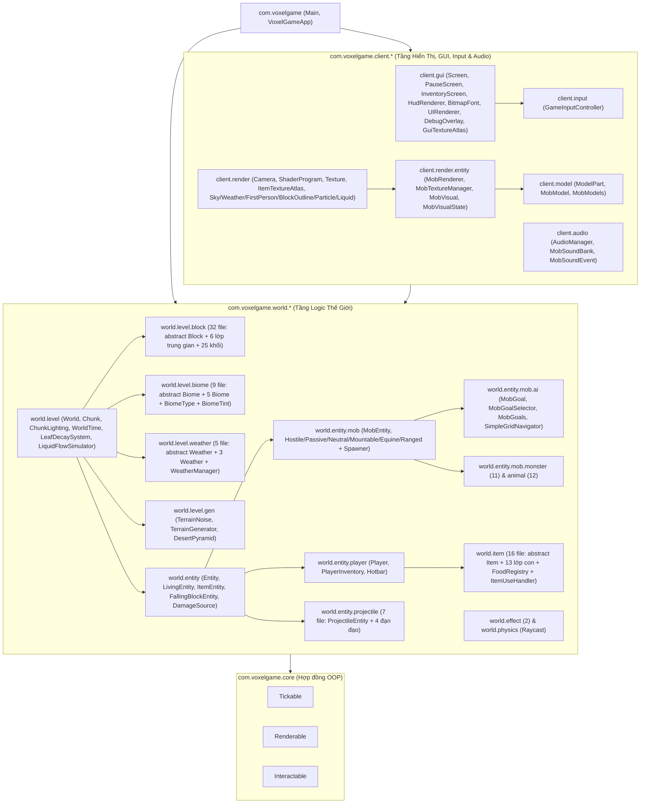
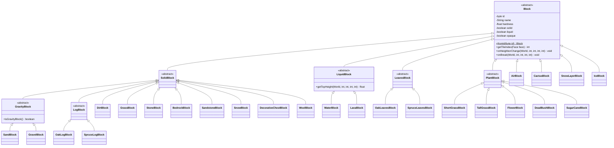
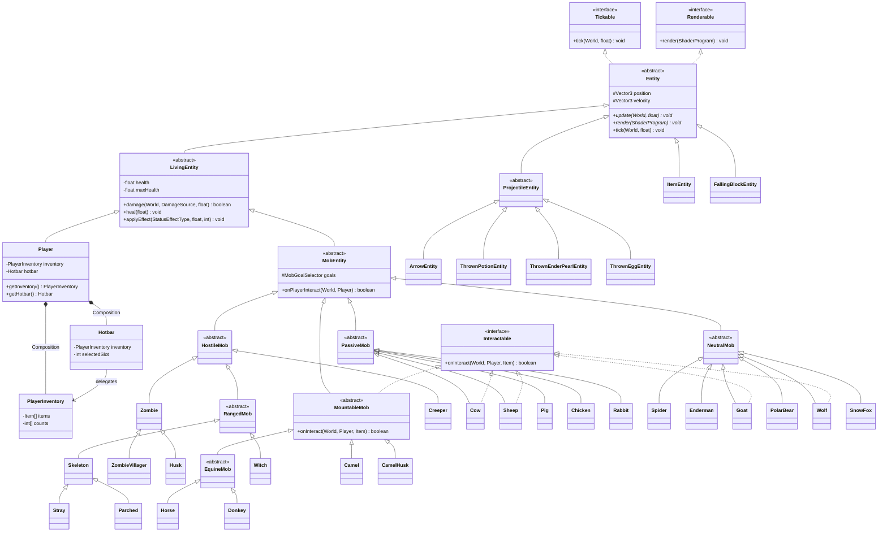
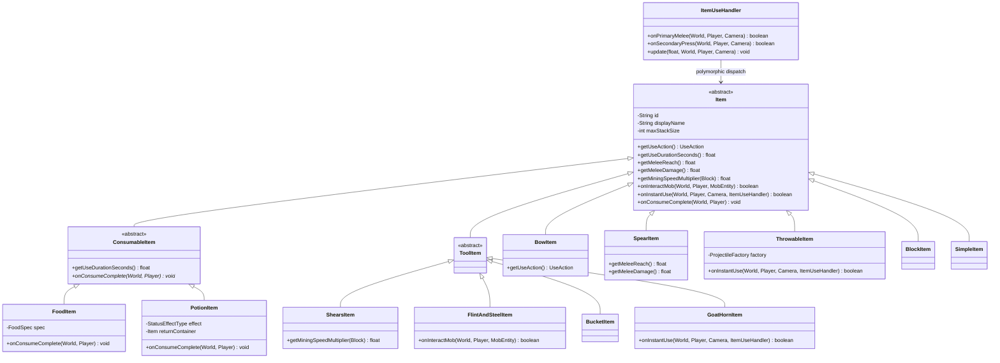
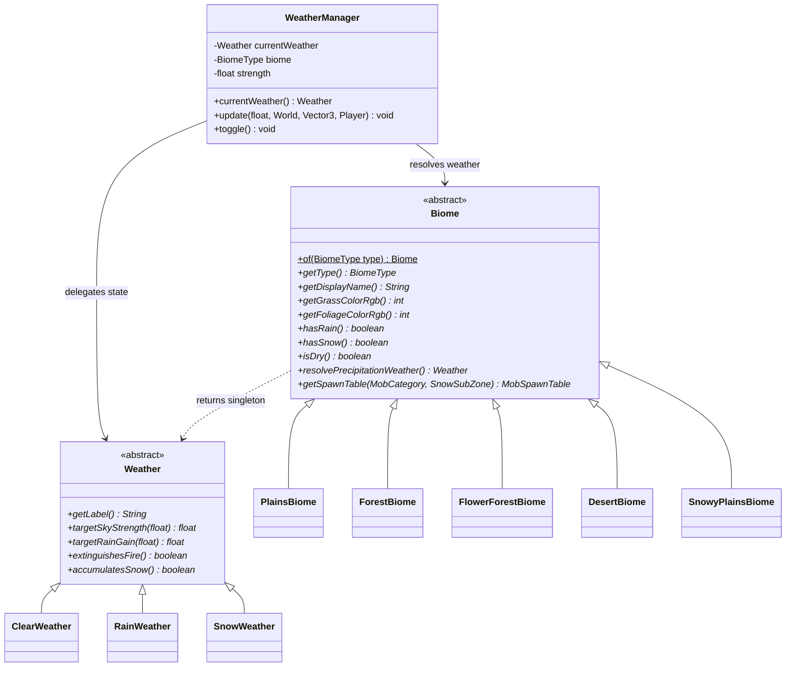
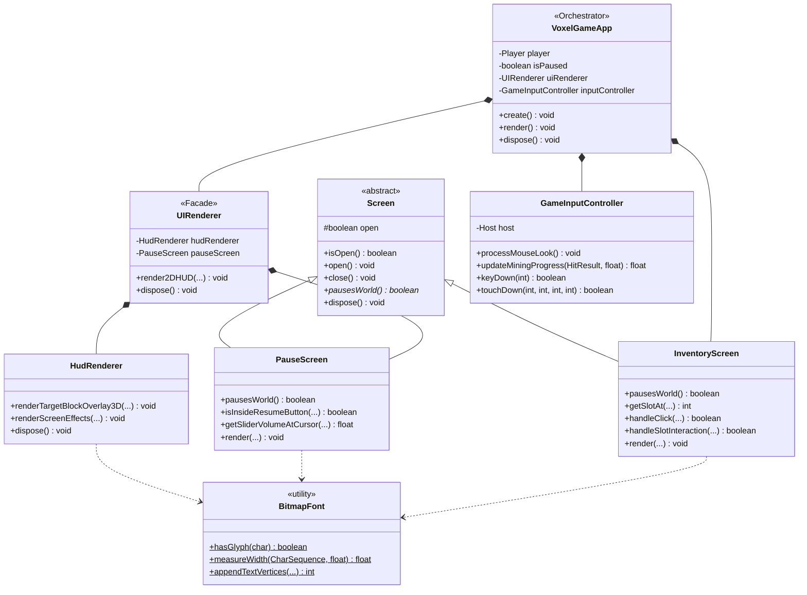

# Kiến Trúc Tổng Quát & Sơ Đồ Lớp Dự Án VoxelGame

Tài liệu này mô tả kiến trúc phân gói chuẩn **Minecraft Java Edition** của dự án **VoxelGame** (`168` file Java chính, `28` bộ kiểm thử CPU) cùng các sơ đồ lớp Mermaid chi tiết cho từng phân hệ.

---

## 1. Sơ Đồ Kiến Trúc Phân Gói Tổng Quát

---

## 2. Sơ Đồ Lớp Hệ Phân Cấp `Block` (`world.level.block`)

---

## 3. Sơ Đồ Lớp Hệ Phân Cấp `Entity`, `Mob` & `Projectile` (`world.entity.*`)

---

## 4. Sơ Đồ Lớp Hệ Phân Cấp `Item` Đa Hình (`world.item`)

---

## 5. Sơ Đồ Lớp `Biome` & `Weather` (State / Strategy Pattern)

---

## 6. Sơ Đồ Tổng Quan Tầng Client, GUI & Input (`client.gui`, `client.input`)

